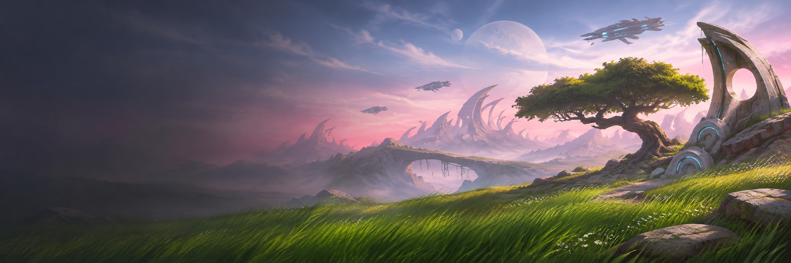

<div align="center">

# Shadow of the Beast - PC Port

### Shadow of the Beast, the PS4 action game, running natively on Windows and experimentally on Linux and Steam Deck, with exclusive True Ultrawide Hor+, up to 4K, up to 240 FPS presentation and modern PC display options

[](https://github.com/saulob/shadow-of-the-beast-pc/releases/latest)
[](https://github.com/saulob/shadow-of-the-beast-pc/releases)
-52616c?style=for-the-badge&labelColor=10151b)

<sub>The game's original PS4 x86-64 code runs directly on the PC, with replacement PS4 system libraries and a Vulkan renderer derived from <a href="https://github.com/shadps4-emu/shadPS4">shadPS4</a>. It is not an emulator. <b>The game itself is not included</b>: bring your own legally obtained Shadow of the Beast PS4 package.</sub>

</div>



## Features

- **True Ultrawide Hor+, exclusive to this PC port**: 21:9 and 32:9 show more of the world at the sides with the same
  vertical view, without stretching the gameplay image. The HUD keeps its 16:9 layout: health stays bottom left and the
  enemy counter bottom right, and the title, map, Options and Wisdom of Shadows screens stay centered
- **Up to 4K internal render resolution**: 480p, 720p, Native (1080p), 1440p, 1800p or 4K. This is the game's own render
  target, not window scaling. A start that fails at a high resolution falls back to a safe one automatically
- **Aspect ratios**: 16:9 Original, 16:10, 21:9 Ultrawide, 32:9 Super Ultrawide, 4:3 and 5:4
- **High frame-rate presentation**: 30, 60 (Original, default), 90, 120, 144, 165, 240 or Unlimited, with deadline-based
  pacing. The game simulation stays at its original 60 Hz: above 60 the latest completed game frame is presented again
  between new game frames, with no motion interpolation, and gameplay does not speed up
- **Graphics**: SMAA, AMD FSR 1 upscaling, RCAS sharpening with adjustable strength, anisotropic filtering (Game, 2x, 4x,
  8x, 16x), VSync and graphics card selection
- **Display**: Windowed and Borderless Fullscreen (**F11** switches while playing), monitor selection, Letterbox or
  Stretch, frame counter (**F2**)
- **Controllers**: Xbox, DualShock 4, DualSense and other SDL gamepads, with rebinding for controller and keyboard.
  **Controller prompts** (Auto, Xbox or PlayStation) puts Xbox button icons into the game's own menus and prompts
- **Menu Button Layout**: Western (Cross/A confirms, default) or each region's Original layout
- **Skip Intro**: skips the publisher and developer logos (off by default)
- **Exit Game** on the Map and Pause screens, with a confirmation
- **Menus and subtitles** in every language the game ships, chosen in the launcher
- **Three supported regional builds** (Korea, USA and Europe) with the same feature set
- **Offline by design**: the PlayStation Network prompts and Social Features are turned off; nothing connects to PSN
- **Local PS4 trophies** shown on the launcher's Trophies page (needs your own Trophy Key, see [Trophies](#trophies))
- **Save data** stored next to the program
- **Launcher with installer**: installs your own `.pkg`, checks the exact build before unpacking, and explains in the log
  when a package is a version the port does not support yet
- **Bug Report page** with a scrubbed log preview, **My reports**, developer replies and player tests. See
  [Reporting problems](#reporting-problems)
- **Self-updater**: the launcher can install a newer release, the Windows ZIP or the Linux AppImage; the game, saves,
  settings and logs are kept

## What you need

- Windows 10 (1903 or newer) or Windows 11, 64-bit, or Linux x86-64 with glibc 2.31 or newer (experimental, see
  [Linux and Steam Deck](#linux-and-steam-deck))
- A graphics card and driver with **Vulkan 1.3**
- A processor with AVX (Intel Sandy Bridge, AMD Bulldozer or newer). The launcher says which instruction set is missing
  if yours cannot run the game
- **Your own legally obtained Shadow of the Beast PS4 package**, as a decrypted (fake) PKG of one of these builds:

| Region | Title ID | Game version | CONTENT_ID | Package | `eboot.bin` SHA-256 |
| --- | --- | --- | --- | --- | --- |
| Korea | `CUSA03762` | 1.00 | `HP9000-CUSA03762_00-SHADOWOFBEAST0KR` | Base game | `ebf1d2fa6f44f05ab141e9b06fd8e60179db3be8b0b57b794ce79448ed133023` |
| USA | `CUSA02871` | 1.00 | `UP9000-CUSA02871_00-SHADOWOFBEAST0US` | Base game | `ebf1d2fa6f44f05ab141e9b06fd8e60179db3be8b0b57b794ce79448ed133023` |
| Europe | `CUSA00951` | 1.00 | `EP9000-CUSA00951_00-SHADOWOFBEAST0EU` | Base game | `7c35e4edc6304dc22f665182fb89385a589d04c9d4a7ac54fd8d4652e74a9343` |

All three builds have the same PC-port features. The PC port version (`0.1.0`) identifies the launcher, runtime and
renderer; the game version (`1.00`) identifies the original game installed from your own package. A package is
recognized by its contents, not its file name. More detail is in [docs/GAME_BUILDS.md](docs/GAME_BUILDS.md).

## Installing

1. Download **ShadowOfTheBeastPC-v&lt;version&gt;-windows-x64.zip** from the
   [latest release](https://github.com/saulob/shadow-of-the-beast-pc/releases/latest) and extract it into a folder you
   can write to. On Linux, download **ShadowOfTheBeastPC-v&lt;version&gt;-x86_64.AppImage** into a folder of its own
   instead and make it executable (`chmod +x`).
2. Run **shadow_of_the_beast.exe** (on Linux, the AppImage). The launcher opens.
3. On the **Play** page click **Install game...** and select your own `.pkg`. The package is only read; the game is
   unpacked into the `game` folder next to the program (about 17 GB).
4. Wait for the page to show the game as ready, then press **PLAY**.
5. To bring the launcher back after turning **Show this launcher** off, hold **Shift** while starting, or start with
   `--launcher`.

**The game itself is not included**: the release contains no game package or executable, and the port does not
download the game.

A package of another version, region or an update is refused, and the installed game is left as it was. When it is
still Shadow of the Beast, the launcher examines it read-only and writes what it found to the log; send that log with
**Bug Report** so the build can be supported.

### Trophies

The trophy list in your game package is encrypted with a Trophy Key, which the port does not include, generate or
download. Type your own key on the **Trophies** page, or import it from an existing shadPS4 `keys.json`. It stays on
this PC and is never logged or sent. Unlocks are recorded even before a key is set and appear once it works. See
[docs/TROPHIES.md](docs/TROPHIES.md).

### Windows SmartScreen

Windows may warn the first time you run the program, because the release is not digitally signed. If you downloaded it
from this repository's releases page, choose **More info**, then **Run anyway**. The SHA-256 of every release file is in
its release notes.

### Saves and settings

Everything is kept next to the program, so copying the whole folder to another PC takes your data with it:

| Path | Contents |
| --- | --- |
| `user\sotb.ini` | Launcher and game settings |
| `user\savedata\` | Your saves, one folder per region |
| `user\trophy\`, `user\keys.json` | Trophy progress and your Trophy Key |
| `user\bug_reports.json` | The Bug Reports you sent, with their private receipts |
| `logs\` | One log per run (and, on Windows, crash dumps) |
| `game\` | The installed game, unpacked from your own package |

Reinstalling the game or updating the port keeps `user\` and `logs\`. On Linux the same folders live beside the AppImage
(see [Linux and Steam Deck](#linux-and-steam-deck)).

## Linux and Steam Deck

**Experimental.** Linux x86-64 runs natively, with the same launcher, options and supported builds as Windows; it is not
Proton or Wine. Each release has an AppImage, **ShadowOfTheBeastPC-v&lt;version&gt;-x86_64.AppImage**, built on Ubuntu
20.04, so it runs on glibc 2.31 or newer (Ubuntu 20.04, SteamOS 3 and later distributions). It needs a Vulkan 1.3 driver.
It is built and checked by the automated tests, but has not yet been tested in gameplay on real Linux or Steam Deck
hardware.

1. Put the AppImage in a folder of its own and make it executable (`chmod +x`, or the file manager's Properties).
2. Run it. FUSE is not required: without it the AppImage extracts itself to a temporary folder for that run.
3. Install the game from the **Play** page as above.

On a Steam Deck, do this in Desktop Mode, then add the AppImage to Steam with **Add a Non-Steam Game**; put `--launcher`
in its Launch Options to open the launcher in Gaming Mode.

`game/`, `user/` and `logs/` are created beside the AppImage, never inside it. When that folder is read-only they go to
`~/.local/share/ShadowOfTheBeastPC`, and the updater cannot install there; `SOTB_PORTABLE_DIR` chooses another
folder. The updater replaces the AppImage file itself after checking its SHA-256.

Differences from Windows:

- Crash dumps (`.dmp`) are Windows-only. On Linux a crash still writes its details to the log, and Bug Report works the
  same way.
- The Direct3D 11 renderer option is Windows-only.
- **Install game...** needs `zenity` or `kdialog` for the file dialog.
- Holding **Shift** to reopen the launcher works under X11; on Wayland start with `--launcher`.

More detail, and how to build and package it, is in [docs/LINUX.md](docs/LINUX.md).

## Reporting problems

The easiest way is the launcher's **Bug Report** page:

1. Describe the problem.
2. Choose the log of that session. Each one says how it ended, for example **Crash detected** or **GPU device lost**.
3. Check the preview. The log is scrubbed before the preview is built: user and computer names, private folders,
   addresses and secrets become placeholders, while crash and graphics diagnostics stay. The preview is exactly what is
   sent.
4. Press **Send report**. Nothing is sent before that.

Every report returns a **Report ID**. **My reports** on the same page lists the reports sent from this PC with their
status, and marks a **New reply** when the developer writes. When a fix is ready to try, the report shows **Awaiting
player test** and asks **Yes, fixed** or **No, still happening**; after **No, still happening** you can send a new report
with a fresh log. No account is needed.

On Windows, when the game crashed, **Attach crash report** adds that session's crash dump. The dump holds thread stacks
and the list of loaded modules, which are a small part of the game's memory; clear the box to send the log alone. If the
dump upload is interrupted it resumes, under the same Report ID.

When the installer refuses a game version it does not support, the diagnosis is already in the log; send it the same way.

You can also open an [issue](https://github.com/saulob/shadow-of-the-beast-pc/issues) and attach the newest log from the
`logs` folder.

## Known limitations

- **Linux and Steam Deck** are experimental and not yet tested in gameplay on real hardware; see
  [Linux and Steam Deck](#linux-and-steam-deck).
- **Vulkan 1.3 is required.** The launcher also offers OpenGL and Direct3D 11 renderers, labelled experimental; they have
  not been verified with this game and do not run SMAA, FSR 1, sharpening or the ultrawide side fill.
- **Shapes other than 16:9** keep prerendered videos at 16:9. On the title, map and loading screens the game only draws its
  central 16:9 part; with True Ultrawide the sides are filled from the scene.
- **4K and the other resolutions above 1080p** need a powerful graphics card.
- **Trophies** need your own Trophy Key, and there is no in-game trophy notification.

## Building it yourself

### Windows (MSYS2 CLANG64)

```powershell
.\tools\setup.ps1                # checks and installs the prerequisites
.\tools\build.ps1                # incremental build into build\cmake\clang64\bin
.\tools\test.ps1                 # headless tests for Windows, with the supported-build parity and version contracts
.\tools\test.ps1 -Full           # the complete matrix and release gate, Windows and Linux (through WSL)
.\tools\package.ps1              # dist\ShadowOfTheBeastPC-v<version>-windows-x64.zip and its .sha256
```

`tools\test.ps1` opens no window, starts no game and contacts no server. It checks the three supported builds against
every build-keyed patch and table, applies all patches together to each build's prepared boot image (read only), and
under `-Full` builds the Linux program in WSL, runs its suites and compares the Windows and Linux feature contracts. A
build without a prepared boot image is reported as BLOCKED, never as a pass.

`tools\package.ps1` builds the release locally and checks the staged folder for game data, user data, logs, dumps, debug
files and local paths before writing the ZIP. It does not publish, tag or upload anything. The release version is the
project `VERSION` in `CMakeLists.txt`.

### Linux (x86-64)

```sh
sudo bash packaging/linux/ci-deps.sh   # once, on Ubuntu 20.04 (the glibc 2.31 baseline)
bash tools/build.sh                    # build/cmake/linux/bin/shadow_of_the_beast
bash tools/build.sh --test             # also builds and runs the headless Linux suites
bash tools/package-linux.sh            # dist/ShadowOfTheBeastPC-v<version>-x86_64.AppImage and its .sha256
```

`tools\package-release.ps1` prepares both release files from Windows: it runs `tools\test.ps1 -Full`, packages the ZIP,
builds and packages the AppImage in an Ubuntu 20.04 WSL distribution, compares the two release builds' parity contracts,
and writes the release notes and VirusTotal manifests with every checksum. Nothing is published or uploaded. The
VirusTotal steps before publishing are in [docs/RELEASE_SECURITY.md](docs/RELEASE_SECURITY.md); see
[docs/LINUX.md](docs/LINUX.md) for the requirements and the other commands.

### Repository layout

| Path | Purpose |
| --- | --- |
| `src/` | Native loader, PS4 system-library runtime, game patches, trophies |
| `gpu/` | shadPS4-derived Vulkan video core, shader recompiler, GnmDriver, VideoOut |
| `launcher/` | TRG launcher pages, PKG installer, build identification, Bug Report and updater |
| `server/shadow-bug-reports/` | The Cloudflare Worker that receives Bug Reports, with its dashboard and tests |
| `tests/` | Headless test suites |
| `tools/` | Build, test and packaging scripts (Windows and Linux) |
| `scripts/` | Read-only PKG inspection and developer preparation |
| `packaging/` | Application icons, packaged READMEs, third-party licenses, Linux build environment, AppImage files |
| `patches/` | The pinned AppImage runtime's patch (the extract-and-run fallback without FUSE) |
| `assets/` | Launcher art and icons, controller prompt sources |
| `docs/` | Launcher, graphics, builds, Linux and runtime documentation |

## Sponsoring

Shadow of the Beast PC is maintained and developed in my free time. If you enjoy the project or find it useful, consider supporting its continued development.

<p align="center">
<a href="https://github.com/sponsors/saulob" target="_blank"></a>
</p>

## Credits

- Shadow of the Beast belongs to its respective rights holders. This is an unofficial fan-made PC port. It is not
  affiliated with or endorsed by Sony Interactive Entertainment, Heavy Spectrum Entertainment Labs or any other rights
  holder, and it contains no game package or executable.
- [shadPS4](https://github.com/shadps4-emu/shadPS4) for the Vulkan renderer, shader recompiler, GnmDriver and VideoOut
  the video core is built on (GPL-2.0-or-later; see `gpu/VENDOR.txt`)
- The shared PS4 port infrastructure of the [Dragon's Crown Pro](https://github.com/saulob/dragons-crown-pro-pc),
  [Alienation](https://github.com/saulob/alienation-pc),
  [Odin Sphere Leifthrasir](https://github.com/saulob/odin-sphere-leifthrasir-pc),
  [13 Sentinels: Aegis Rim](https://github.com/saulob/13-sentinels-aegis-rim-pc) and
  [God of War: Sons of Sparta](https://github.com/saulob/god-of-war-sons-of-sparta-pc) PC ports
- [TRG Launcher](https://github.com/TekRantGaming/trg-launcher), the launcher interface (MIT)
- [SMAA](https://github.com/iryoku/smaa) by Jorge Jimenez et al., and AMD FidelityFX Super Resolution 1
- [LibAtrac9](https://github.com/Thealexbarney/LibAtrac9) by Alex Barney for ATRAC9 audio decoding
- [FFmpeg](https://ffmpeg.org) (LGPL-2.1-or-later build) for the game's movies
- The Xbox controller outline is from the [Gamepad Line Art Pack](https://gidedin.itch.io/gamepad-line-art-pack) by
  gidedin (CC0)
- The licenses of every library the release includes are in the `licenses` folder of the ZIP, in
  `usr/share/licenses/ShadowOfTheBeastPC` inside the AppImage and in
  [packaging/licenses/THIRD-PARTY-LICENSES.txt](packaging/licenses/THIRD-PARTY-LICENSES.txt)

## AI disclosure

AI tools were used to assist with code analysis, development, debugging and documentation. Changes were directed, tested and reviewed by the maintainer.

## License

Original code in this project is licensed under the GNU General Public License v2.0 or later (GPL-2.0-or-later). See [LICENSE](LICENSE).

Third-party components retain their respective licenses and notices. See [packaging/licenses/THIRD-PARTY-LICENSES.txt](packaging/licenses/THIRD-PARTY-LICENSES.txt).

The game package and executable are not included. Shadow of the Beast and its assets are not covered by this project's license.
